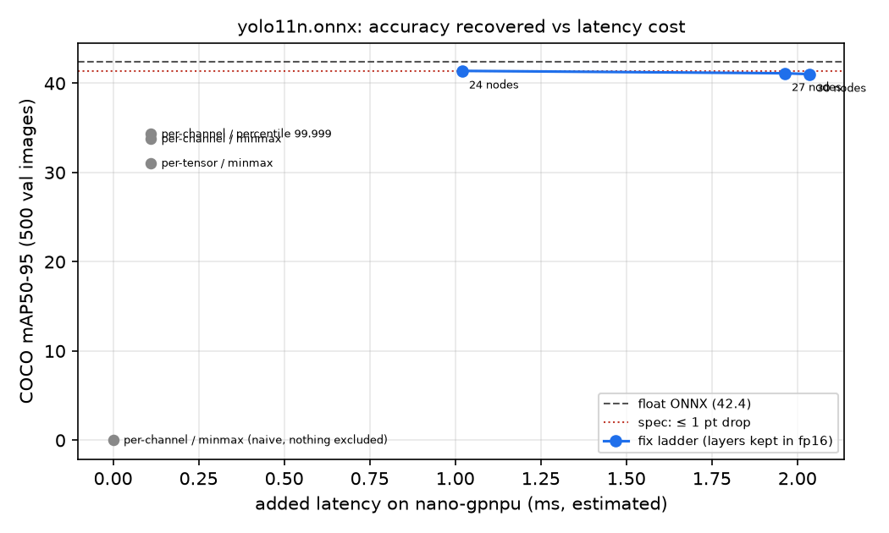
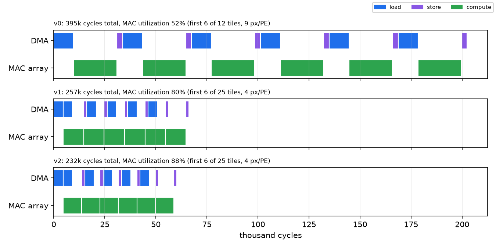

# edge-npu-port

**Will this model run on that edge chip? How fast? What will int8 cost — in accuracy *and* in milliseconds?**

`edge-npu-port` is a vendor-neutral first-pass feasibility check for ONNX models, with measured error bars. It's a CLI and an MCP server, so a person or an agent (Claude Code) can run a port the same way:

| Command | Answers |
|---|---|
| `edgeport twin` | Is the ONNX export a faithful copy of the PyTorch model? |
| `edgeport inspect` | Which ops run on the MAC array, ALUs, or need a custom kernel / CPU fallback? Do weights and activations fit on-chip? |
| `edgeport estimate [--validate local]` | Per-layer roofline latency on a hardware profile, checked against measured per-layer time |
| `edgeport quant-doctor` | Where int8 accuracy goes (stage by stage), which layers cause it, and what each fix costs in ms on the target |
| `edgeport kernel` | One real int8 layer on a C++ tile-level simulator of a GPNPU-style core: bit-exact checks, cycle timeline |
| `edgeport check` | Pass/fail gate for CI (latency budget, peak memory, CPU fallbacks) |
| `edgeport aihub` | Profile the int8 model on a real Snapdragon NPU (Qualcomm AI Hub) and compare per-module bottlenecks with the estimate |

Built in one day (Nov 2026) with an agentic workflow (Claude Code). Every number below is reproducible with the commands in [Quickstart](#quickstart); raw results are in [`docs/results/`](docs/results).

---

## Case study: YOLO11n on a Nano-class GPNPU

**Spec (a typical warehouse-robot request, not a real customer):** YOLO11n at 640×640, **≥ 60 FPS (≤ 16.7 ms)**, **≤ 1.0 mAP50-95 drop** from float, on one small GPNPU core.
The core is modeled on publicly documented GPNPU architectures (e.g. Quadric Chimera): 64 PEs × 8 int8 MACs, 1 GHz, 1 MB L2, 16 GB/s DDR. [Assumed numbers are labeled.](src/edge_npu_port/profiles/nano-gpnpu.yaml)

### Verdict: likely, but the margin is thin — measure before committing

| Step | Result |
|---|---|
| Twin | ONNX = PyTorch to ≤ 3e-5 relative; **identical mAP** (42.37 vs 42.37). A 1%-corrupted weight is caught by the numeric check even though every detection still matched |
| Inspect | 3.27 GMAC/frame. Weights 2.54 MB and peak activations 3.42 MB both exceed 1 MB on-chip. Conv+SiLU fusion cuts peak memory 27% and halves the layers that overflow on-chip memory (43 → 22). No CPU fallbacks |
| Estimate | **8.73 ms** (52% of budget). MAC roofline is 6.39 ms (73% utilization). The detection head is 29% of the time |
| Validation (M5 Pro CPU) | The method under-predicted by **−42%** after calibrating on a representative conv (−65% with a GEMM ceiling) |
| int8 | Naive int8 = **0 mAP**. Fixed: **41.38 (−0.99)** for **+1.02 ms** |
| Kernel | Slowest 1×1 conv: **394.6k → 231.8k cycles** (v0 → v2, roofline 204.8k), bit-exact |
| Real NPU (Galaxy S25, Snapdragon 8 Elite) | **1.77 ms measured**, 345/345 ops on the NPU. The estimator ranks bottlenecks with **Spearman 0.91** (top 3 identical). The fp16 decode tail is **57% of NPU cycles** |

On paper: 8.73 + 1.02 = **9.75 ms**, which meets 60 FPS.
But if this core loses to layer shapes what the M5 CPU lost (−42%), the real figure is **~16.8 ms**, right at the budget.
The honest answer is "likely, pending measurement on silicon or the vendor simulator," not "yes."

### What the real NPU showed

On a Snapdragon 8 Elite (AI Hub, real device):
- int8 YOLO11n runs end to end in **1.77 ms**.
- The estimator found the same top-3 bottlenecks as the device (ρ = 0.91 over 24 modules). Absolute per-op times can't be checked: QNN's per-op cycle counts aren't a consistent wall-clock unit across models (3.3 vs 9.2 "cycles/ns").
- **The accuracy fix is the biggest cost there:** the decode tail kept in float runs as fp16 and takes 57% of NPU cycles. The next fix is to export boxes and scores as separate outputs, so each gets its own int8 scale.

### The int8 failure, and how it was found



- YOLO's last `Concat` puts box coordinates (0–640 px) and class scores (0–1) in one tensor. One int8 scale of ≈ 2.57 per step rounds **every score to 0**.
- **Per-tensor SQNR misses it.** That tensor's error is dominated by the big box values, so it looks healthy.
- `quant-doctor` adds a **range-mixing check**: the effective bits each Concat input keeps under the shared scale. Scores keep **−1.44 bits**.
- Then it compares configs with the blocker fixed. Per-channel + percentile wins. It also keeps the 24-node decode tail in float, and prices each fix on the target.
- Keeping the lowest-SQNR layers in float made accuracy slightly *worse*. Fixes are judged by the task metric.

### The kernel

`/model.16/cv1` (256→64 ch, 80×80) is the slowest 1×1 conv in the estimate. It's run on real data from the int8 model.



- The kernel fuses the int8 dot product (zero point folded into the bias), gemmlowp fixed-point requantization, and a 256-entry SiLU lookup table.
- **Bit-exact** vs a scalar C++ reference and a numpy integer reference, on the real layer and on random shapes with partial tiles.
- vs ONNX Runtime int8: 99.96% within ±1 LSB. The worst case (4 LSB) is traced to one requantization rounding difference times the lookup table's slope.
- **Double buffering** (v1) hides DMA behind compute: −35% cycles, even though it halves the tile size. **Overlapping the weight broadcasts** (v2) reaches 88% MAC utilization.
- The plan to keep weights resident failed on the memory budget: 16 KB of weights vs 4 KB per PE.

---

## Quickstart

```bash
uv sync
uv run edgeport twin                                   # downloads yolo11n.pt, exports models/yolo11n.onnx
uv run edgeport inspect models/yolo11n.onnx --hw nano-gpnpu
uv run edgeport estimate models/yolo11n.onnx --hw nano-gpnpu --budget-ms 16.7
uv run edgeport check models/yolo11n.onnx --hw nano-gpnpu --max-ms 16.7
```

Validate the estimator on your own machine:

```bash
uv run edgeport calibrate --name my-cpu                # microbenchmarks -> profiles/my-cpu.yaml
uv run edgeport estimate models/yolo11n.onnx --hw profiles/my-cpu.yaml --validate local
```

Accuracy and kernels need COCO (val2017 + annotations, coco128) in `data/` and the simulator built:

```bash
uv run edgeport quant-doctor models/yolo11n.onnx       # ~10 min on a laptop
uv run cmake -S sim -B sim/build -G Ninja && uv run cmake --build sim/build
uv run edgeport kernel
uv run pytest -q tests
```

**With Claude Code:** `.mcp.json` registers the MCP server (`uv run edgeport-mcp`). The [`port-model`](.claude/skills/port-model/SKILL.md) skill walks an agent through a port as a series of gates.

---

## What this is not

- **Not a vendor spec.** The Nano-class profile is built from public material; local memory, L2 bandwidth, DMA latency and per-layer overhead are assumptions, printed in every report. The simulator is a teaching-grade *performance model*, not an instruction-set simulator, and it has not been validated against Chimera silicon.
- **The estimator is a lower bound** until calibrated per device. On an M5 Pro CPU it under-predicted by 42%; on a Snapdragon NPU it ranks bottlenecks well (ρ = 0.91), but absolute per-op time couldn't be validated from QNN's cycle counts.
- **Accuracy numbers come from a 500-image subset** of COCO val2017. A 0.99 drop against a 1.0 budget is inside that subset's noise. Confirm on the full set.
- **Tools to use once you've picked a chip:** vendor toolchains go deeper on their own silicon. Examples: Qualcomm AI Hub (measured on real devices), Arm Vela, the Hailo DFC, and AIMET for quantization analysis. This tool is the first pass before that choice.

## Roadmap

1. **v0.1 (this).** Three commands plus `check`, MCP, the YOLO11n case study, M5 validation.
   Real-NPU check on Qualcomm AI Hub (done: ρ = 0.91, 1.77 ms).
   *Next fix:* split boxes and scores into separate outputs so the decode tail stays int8.
2. **v0.2: calibrated predictor.** Fit a per-device correction on measured layers. Report error on a *different* model than the one it was fitted on, and publish error per profile.
3. **v0.3: open hardware-profile database.** Profiles accepted only with measurements attached.
4. **v0.4: `estimate --llm`.** Prefill vs decode rooflines, KV cache, W4A16.
5. **Later: "which chip?" recommender**, only once the error bars justify it.

## Layout

```
src/edge_npu_port/   twin, graph, inspect_model, estimate, calibrate, validate,
                     quant_doctor, coco_eval, kernel_harness, checks, mcp_server, cli
src/edge_npu_port/profiles/   hardware profiles (YAML, assumptions inline)
profiles/            measured profiles (m5pro-cpu.yaml)
sim/                 C++17 tile-level simulator + fused int8 kernel (CMake)
docs/img/, docs/results/   charts and raw results behind the numbers in this README
```
